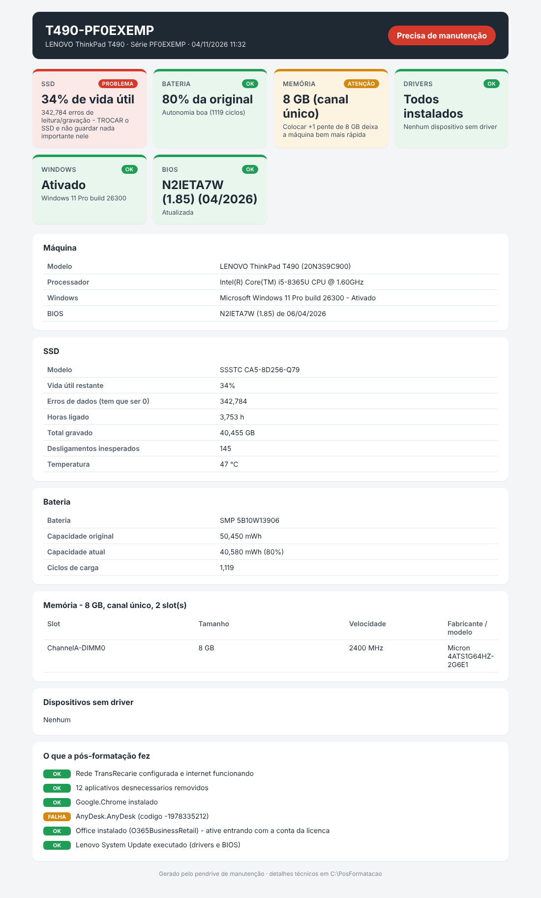
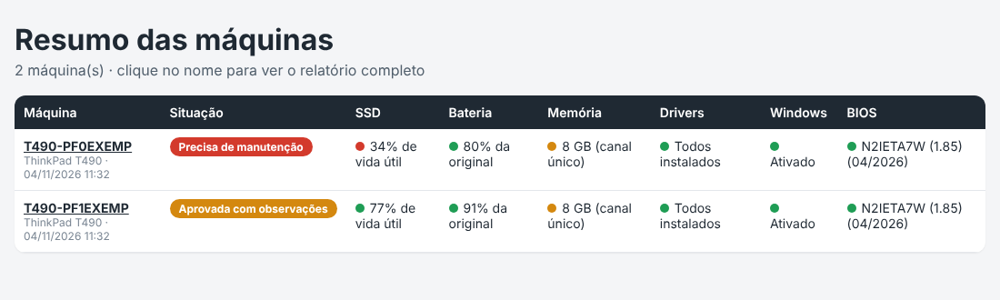

# Pendrive Full

> 🇧🇷 [Português](#-português) · 🇺🇸 [English](#-english)

Pendrive multiboot de manutenção baseado no [Ventoy](https://github.com/ventoy/Ventoy): formata, instala o Windows 11 sem perguntas, configura a máquina sozinho e entrega um relatório visual da saúde do hardware.

*A Ventoy-based multiboot maintenance USB drive: it reinstalls Windows 11 unattended, configures the machine by itself and produces a visual hardware health report.*



---

## 🇧🇷 Português

> ⚠️ **Projeto em desenvolvimento.** Feito para qualquer PC com Windows 10/11, de qualquer marca. Testado até agora em notebooks Lenovo ThinkPad T490 com Windows 11 Pro. Use por sua conta e risco e teste numa máquina antes de usar nas outras.

### O que ele faz

**No boot (menu do Ventoy)**
- Instala o Windows 11 (ou o 10, para PCs que não aceitam o 11) com o arquivo de respostas `autounattend.xml`: português, teclado ABNT2, conta local sem e-mail da Microsoft, sem telas de privacidade. **A escolha do disco continua manual**, para nunca apagar o disco errado.
- Ferramentas de boot: MemTest86 (memória), Rescuezilla (backup/clonagem), SystemRescue (partições, TestDisk/PhotoRec), netboot.xyz (baixa outros sistemas pela rede), ShredOS (apagar disco).
- Linux live: Linux Mint XFCE (leve, para PCs fracos e resgate de arquivos) e Kali Linux (instalador; segurança e redes).
- **Diagnóstico sem Windows:** no menu do Ventoy, "Linux Mint XFCE + DIAGNOSTICO" abre o Linux e roda sozinho o diagnóstico (SSD/HD pelo SMART, bateria, memória, processador, BIOS). O resultado aparece na tela e o relatório, igual ao do Windows, é salvo no pendrive e entra no resumo das máquinas. Feito com o [LiveInjection](https://github.com/ventoy/LiveInjection) do Ventoy (código em `linux-diagnostico/`).
- Ferramentas portáteis no Windows: CrystalDiskInfo (SSD), HWiNFO (hardware e temperaturas), **teste de estresse** com Prime95 (processador e memória) e FurMark 2 (placa de vídeo), e **teste das portas USB** com USB Device Tree Viewer e CrystalDiskMark.
- `ISOs/SHA256-OFICIAIS.txt` lista o SHA-256 oficial de cada ISO para conferir o download.
- Se a máquina reiniciar com o pendrive conectado e ninguém escolher nada, em 10 segundos ela entra no Windows instalado.

**Painel (`PAINEL.bat`)**
- Uma janela só, em modo escuro, com a saúde da máquina (SSD, bateria, memória, drivers) logo ao abrir.
- Três caminhos: **Pós-formatação** (PC recém-formatado), **Otimizar** (PC em uso) e **Relatório** (não altera nada), e atalhos para as ferramentas do pendrive.
- Abas **Otimizar / Instalar / Remover**: você marca o que quer. O que já está instalado aparece apagado, e a lista de remoção mostra só os apps que existem **naquele** PC.
- Andamento ao vivo, passo a passo, e botão para abrir o relatório no final. Português e inglês.
- No primeiro login depois da formatação ele abre sozinho e começa em 60 segundos se ninguém mexer.

**Depois da instalação (`POS-FORMATACAO.bat`, ou sozinho no primeiro login)**
1. Energia: não dorme na tomada durante o processo.
2. Wi-Fi: se não houver internet, lista as redes disponíveis para a pessoa escolher e digitar a senha (e pode salvar no pendrive para as próximas máquinas).
3. Limpeza: remove apps desnecessários e propagandas, mostra extensões de arquivo.
4. **Privacidade e otimização:** telemetria no mínimo que o Windows aceita, sem envio de dados de uso, sem Bing/Copilot/Recall, tarefas de coleta desligadas, visual mais leve, Inicialização Rápida desligada, limpeza automática e TRIM do SSD. Defender e Windows Update continuam ligados.
5. **Você escolhe tudo numa janela no início** (Wi-Fi, programas e otimização) e o resto é automático. Programas disponíveis: Chrome, Firefox, 7-Zip, Adobe Reader, VLC, AnyDesk, TeamViewer, Zoom, Teams, LibreOffice, Notepad++, Office. Instala via `winget` e **pula o que já está instalado**. O Office baixa em segundo plano enquanto as outras etapas rodam.
6. Microsoft 365 Apps (Office), se marcado, pelo instalador oficial da Microsoft.
7. Chrome na barra de tarefas no lugar do Edge (o Edge fica escondido, não é desinstalado) e, no fim, **1 clique** para confirmar o Chrome como padrão: o Windows 11 não deixa nenhum programa trocar o navegador padrão sozinho. O script confere se ficou.
8. Drivers e BIOS: em computadores Lenovo, pelo Lenovo System Update (espera ele terminar de verdade).
9. **Windows Update completo:** instala todas as atualizações e drivers pendentes, sem reiniciar sozinho.
10. Renomeia o PC (`MODELO-SÉRIE`) e gera o relatório.

**Relatório visual**
- Cartões verde/amarelo/vermelho para SSD, bateria, memória, drivers, ativação do Windows e BIOS, com uma frase dizendo o que fazer.
- `Relatorios/Resumo-das-maquinas.html` no pendrive compara todas as máquinas já atendidas.
- `RELATORIO.bat` gera só o relatório, sem alterar nada no PC.

**PC em uso (`OTIMIZAR.bat`)**
- Para um computador que já tem arquivos e programas importantes: cria um **ponto de restauração** antes, aplica só privacidade, otimização e limpeza de temporários, e gera o relatório.
- **Não** desinstala programas ou apps, **não** mexe em arquivos, **não** troca navegador nem barra de tarefas, **não** renomeia o PC e **não** atualiza a BIOS.
- O relatório mostra quanto tempo levou cada etapa.



### Estrutura

```
pendrive/                       → conteúdo da raiz do pendrive Ventoy
├── PAINEL.bat                  → painel gráfico (tudo numa janela)
├── POS-FORMATACAO.bat          → pós-formatação completa
├── RELATORIO.bat               → só o relatório
├── OTIMIZAR.bat                → só otimizar um PC em uso
├── PosFormatacao/
│   ├── pos-formatacao.ps1      → o motor (faz o trabalho)
│   ├── painel.ps1              → o painel gráfico
│   └── config.example.json     → copie para config.json e preencha
├── ventoy/
│   ├── ventoy.json             → configuração do Ventoy
│   └── script/autounattend.xml → instalação automática do Windows 11
├── ISOs/                       → ISOs (não versionadas, ver LEIA-ME de cada pasta)
├── Drivers/  Portateis/        → programas portáteis (não versionados)
docs/                           → imagens do README
```

### Como montar o seu

1. Instale o Ventoy no pendrive (exFAT, GPT e, em Opções, marque **Secure Boot Support**). Essa opção é do instalador do Ventoy, não da BIOS: ela permite dar boot também em PCs com Secure Boot ligado. Na primeira vez num PC assim, o Ventoy pede para registrar a chave (*Enroll key*), uma vez só. Com o Secure Boot desligado na BIOS também funciona.
2. Copie o conteúdo da pasta `pendrive/` para a raiz do pendrive.
3. Baixe as ISOs e ferramentas indicadas no `LEIA-ME.txt` de cada pasta, sempre dos sites oficiais.
4. (Opcional) Copie `PosFormatacao/config.example.json` para `config.json` para fixar Wi-Fi, programas e Office. Sem ele, o script pergunta o Wi-Fi na hora.
5. Coloque as ISOs do Windows em `ISOs/Windows/`: todas elas usam a instalação automática.

> 🔒 O `config.json` guarda a senha do Wi-Fi e **não** vai para o repositório (`.gitignore`).

### Licença

A definir antes da publicação. As ferramentas de terceiros (Ventoy, MemTest86, etc.) **não** são redistribuídas aqui: cada uma é baixada do site oficial e segue a sua própria licença.

---

## 🇺🇸 English

> ⚠️ **Work in progress.** Built for any Windows 10/11 PC of any brand. So far tested on Lenovo ThinkPad T490 laptops with Windows 11 Pro. Use at your own risk and test on one machine first.

> 🌐 The pendrive itself is currently in Brazilian Portuguese. A language selector (Portuguese / US English) is on the [roadmap](ROADMAP.md).

### What it does

**At boot (Ventoy menu)**
- Installs Windows 11 (or 10, for PCs that can't run 11) with an `autounattend.xml` answer file: local account without a Microsoft account, no privacy screens. **Disk selection stays manual**, so it never wipes the wrong drive.
- Boot tools: MemTest86 (RAM), Rescuezilla (backup/cloning), SystemRescue (partitions, TestDisk/PhotoRec), netboot.xyz (boots other systems over the network), ShredOS (disk wipe).
- Live Linux: Linux Mint XFCE (lightweight, for weak PCs and file rescue) and Kali Linux (installer; security and networking).
- **Diagnostics without Windows:** the Ventoy entry "Linux Mint XFCE + DIAGNOSTICO" boots Linux and runs the health check by itself (SSD/HDD via SMART, battery, RAM, CPU, BIOS). Results show on screen and the same report as on Windows is saved to the drive and added to the machines summary. Built with Ventoy's [LiveInjection](https://github.com/ventoy/LiveInjection) (source in `linux-diagnostico/`).
- Portable Windows tools: CrystalDiskInfo (SSD), HWiNFO (hardware and temperatures), **stress testing** with Prime95 (CPU and RAM) and FurMark 2 (graphics card), and **USB port testing** with USB Device Tree Viewer and CrystalDiskMark.
- `ISOs/SHA256-OFICIAIS.txt` lists each ISO's official SHA-256 to verify downloads.
- If the machine reboots with the drive plugged in and nobody picks anything, it boots the installed Windows after 10 seconds.

**Panel (`PAINEL.bat`)**
- One dark-mode window showing the machine's health (SSD, battery, RAM, drivers) as soon as it opens.
- Three paths: **Post-install** (fresh PC), **Optimize** (PC in use) and **Report** (changes nothing), plus shortcuts to the drive's tools.
- **Optimize / Install / Remove** tabs: tick what you want. Apps already installed are greyed out, and the removal list only shows apps that exist on **that** PC.
- Live step-by-step progress and a button to open the report at the end. Portuguese and English.
- At the first logon after a reinstall it opens by itself and starts after 60 seconds if nobody touches it.

**After installation (`POS-FORMATACAO.bat`, or automatically at first logon)**
1. Power: no sleep on AC while it runs.
2. Wi-Fi: if there is no internet, lists the nearby networks so the user picks one and types the password (optionally saved on the drive for the next machines).
3. Cleanup: removes bloatware and ads, shows file extensions.
4. **Privacy and optimization:** telemetry at the lowest level Windows accepts, no usage data sent, no Bing/Copilot/Recall, data-collection tasks disabled, lighter visuals, Fast Startup off, automatic cleanup and SSD TRIM. Defender and Windows Update stay on.
5. **You choose everything in one window at the start** (Wi-Fi, apps and optimization) and the rest is automatic. Apps available: Chrome, Firefox, 7-Zip, Adobe Reader, VLC, AnyDesk, TeamViewer, Zoom, Teams, LibreOffice, Notepad++, Office. Installs via `winget` and **skips anything already installed**. Office downloads in the background while the other steps run.
6. Microsoft 365 Apps (Office), if selected, through Microsoft's official deployment tool.
7. Chrome pinned to the taskbar instead of Edge (Edge is hidden, not uninstalled) and, at the end, **one click** to confirm Chrome as default: Windows 11 does not let any program change the default browser by itself. The script checks it took effect.
8. Drivers and BIOS: on Lenovo machines, through Lenovo System Update (waits until it really finishes).
9. **Full Windows Update:** installs every pending update and driver, without rebooting by itself.
10. Renames the PC (`MODEL-SERIAL`) and builds the report.

**Visual report**
- Green/yellow/red cards for SSD, battery, RAM, drivers, Windows activation and BIOS, each with a plain-language next step.
- `Relatorios/Resumo-das-maquinas.html` on the drive compares every machine serviced.
- `RELATORIO.bat` builds only the report, without changing anything on the PC.

**PC in use (`OTIMIZAR.bat`)**
- For a computer that already has important files and apps: creates a **restore point** first, applies only privacy, optimization and temp-file cleanup, and builds the report.
- It does **not** uninstall apps, touch files, change the browser or taskbar, rename the PC or update the BIOS.
- The report shows how long each step took.

### Build your own

1. Install Ventoy on the USB drive (exFAT, GPT and, under Options, tick **Secure Boot Support**). This is a Ventoy installer option, not a BIOS setting: it lets the drive boot on PCs with Secure Boot enabled. The first time on such a PC, Ventoy asks you to enroll its key, once. It also works with Secure Boot disabled in the BIOS.
2. Copy the contents of `pendrive/` to the root of the drive.
3. Download the ISOs and tools listed in each folder's `LEIA-ME.txt`, always from the official sites.
4. (Optional) Copy `PosFormatacao/config.example.json` to `config.json` to preset Wi-Fi, apps and Office. Without it, the script asks for Wi-Fi on the spot.
5. Put Windows ISOs in `ISOs/Windows/`: every ISO there uses the unattended install.

> 🔒 `config.json` holds the Wi-Fi password and is **not** committed (`.gitignore`).

### License

To be decided before the public release. Third-party tools (Ventoy, MemTest86, etc.) are **not** redistributed here: each one is downloaded from its official site and keeps its own license.
